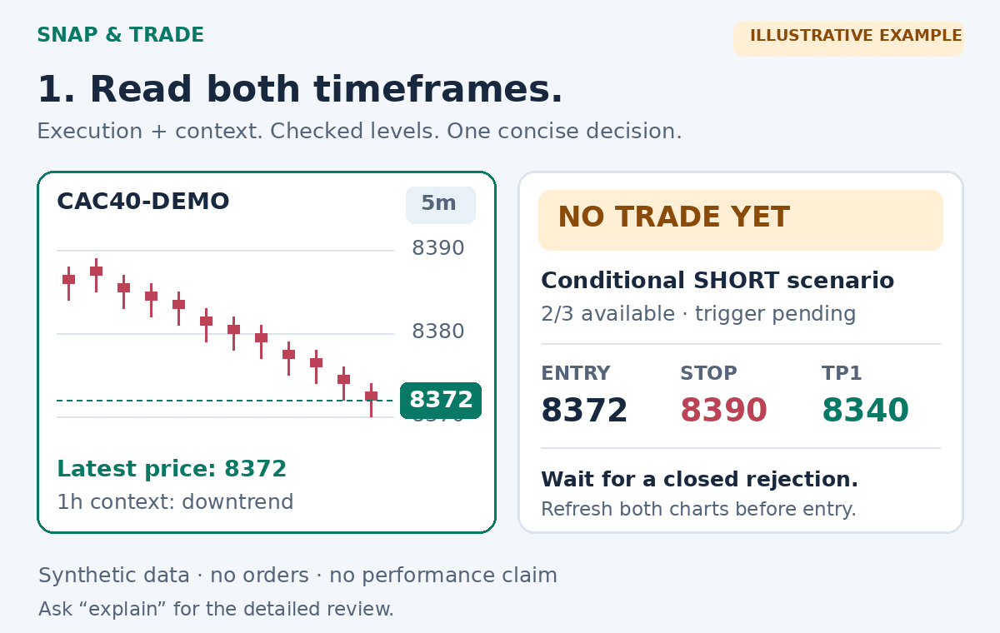

# 📸 Snap & Trade

[](https://github.com/Kirby54/Snap-Trade/actions/workflows/tests.yml)


A chart-review and trade-journaling skill by [Kirby54](https://github.com/Kirby54).
Send an execution chart **and a higher timeframe of the same instrument**
(e.g. 5m + 1h). Get a short **LONG, SHORT or NO TRADE** card, with checked
entry/stop/targets, reward-to-risk and optional position sizing.



*Illustrative animation drawn from synthetic inputs, not a recorded model
session, real market data, or evidence of trading performance.*

## What changed in v2.3

- **Available-evidence score:** 3/3 when only three criteria are available,
  not 3/5. Absent indicators or unavailable index volume are excluded; weak
  displayed signals still count as negative. The score is not a win probability.
- **Structural stop + candle floor:** screenshot plans must have at least
  1.5 times the average high-low range of recent closed candles between entry
  and stop. If the structure and net reward/risk cannot support it, NO TRADE.
- **Two-timeframe context:** request the higher chart when missing; do not
  guess trend from a gap or silently hide missing context in a low score.
- **Price-source checks:** prefer the latest-price axis label; cursor OHLC
  and a quote panel may show different prices. Flag discrepancies.
- **Closed session:** a conditional opening plan with explicit gap-cancellation
  bounds, expiry and a fresh-chart check before any entry.
- **Short output by default:** ask “explain” for the detailed analysis.
- **Both directions:** entry, exit and simulation support long/short analysis;
  short sizing requires explicit permission in user configuration.

The candle floor and confidence labels are provisional heuristics, not
statistically calibrated risk models. They need evaluation on held-out data.

## Installation

**Claude Code plugin:**

```text
/plugin marketplace add Kirby54/Snap-Trade
/plugin install snap-and-trade@snap-and-trade
```

**Manual:** copy `skills/snap-and-trade` to `~/.claude/skills/`
(Windows: `%USERPROFILE%\.claude\skills\`).

**Claude.ai:** download the installable skill ZIP from
[Releases](https://github.com/Kirby54/Snap-Trade/releases), or zip the
`skills/snap-and-trade` folder, and import it through
*Settings > Capabilities > Skills*. Hosted-product access and feature
availability depend on your account.

Python 3.10+; runtime and tests use the standard library. Analysis does not
need a market-data API key. Optional broker integrations require a separate
account, credentials and explicit user approval. Releases include a skill
ZIP with license notices and a SHA-256 checksum.

## Usage

- Attach 5m + 1h images: “Long or short? Short answer.”
- “The market is closed; prepare an opening plan.”
- “Explain the setup and the checks.”
- “Log this trade”, “Trade #4 hit TP1”, “Stats by setup.”

If the latest price, timestamps, context or confirmation are missing, expect
**NO TRADE** plus one concrete request or condition to reassess.

### Example card — synthetic inputs

**NO TRADE NOW — conditional SHORT · CAC40-DEMO · 5m / 1h**

Score **2/3 available**; closed trigger still missing. Volume/indicator
unavailable. Latest price **8372** from axis, not cursor OHLC **8394** or
quote-panel **8361**.

| Level | Price | Condition |
| --- | --- | --- |
| Entry | 8372 | Only after the specified closed trigger and refreshed checks |
| Stop | 8390 | Structural invalidation; distance 18 vs candle floor 15 |
| TP1 / TP2 | 8340 / 8320 | Gross R:R 1.78 / 2.89; costs not provided |

An index chart's prices are not directly executable on a future/CFD.
When closed: opening at/beyond stop or TP1 cancels the scenario. Between
those bounds, wait for fresh confirmation and rerun calculations.

## Modules and market coverage

Includes modules adapted from
[day-trader-skill](https://github.com/Jakeschincariol/day-trader-skill),
with MIT attribution retained.

| Module | Purpose |
| --- | --- |
| scanner | US-stock candidates: breakouts, flags, oversold setups, opening ranges |
| news / analyst | Yahoo headlines, SEC filings and quarterly financials |
| entry / exit | Closed breakout/breakdown trigger, structural stop and target |
| timemachine | Resampled scenarios and historical setup replay; not calibrated odds |
| budget / risk | Position size and PASS/BLOCK against user-configured limits |
| broker / alerts | Approved order tickets and price/session alerts |
| pelosi | Public congressional transaction disclosures |
| journal | Signal/outcome CSV and descriptive R statistics |

| Mode | Markets | Directions and limits |
| --- | --- | --- |
| Screenshot + plan + journal | Readable stocks, crypto, forex, indices, futures charts | Long/short; exact linear instrument specifications required for sizing |
| news, analyst, scanner, pelosi | US stocks / ETFs | Scanner remains long-biased |
| entry, exit, timemachine | US stocks / ETFs | Buy/long and sell/short analysis |
| budget plan mode | US stocks / ETFs | Long by default; short only with explicit `allow_short: true` |
| budget weights mode | US stocks / ETFs | Buy only |
| risk | US stocks / ETFs | Long/short analysis with configured caps and conservative short collateral reserve |
| broker, alerts | US stocks / ETFs | Long entries and exits; broker helper blocks short entries. Default paper/no-margin; exact-order approval required |

Short calculations do not establish borrow availability, margin/collateral,
fees or broker eligibility. No screenshot, score or test places an order.

## Numerical checks

```bash
python skills/snap-and-trade/scripts/plan.py --side short --entry 8372 --sl 8390 --tp 8340 --avg-candle 10 --json
```

Supports conversion (`--fx-rate`), estimated costs (`--cost-per-unit`),
quantity steps/minima and a notional cap. Rounds quantity down, refuses
invalid numbers, orders targets and requires explicit override above 2%
risk of supplied capital. Legacy CLI use without `--avg-candle` remains
possible; screenshot mode requires that volatility check.

[Units, examples and limits](skills/snap-and-trade/references/dimensionnement.md).
`assess.py` checks **recorded observations**, not pixels. It cannot establish
whether the model read an image correctly.

## Evaluation and evidence

**No profitable trading edge or real-image accuracy is demonstrated.**
The repository includes five SHA-256-pinned **synthetic development cases**
for price conflicts, missing context, closed session, tight stops and an
unreadable price. They are not a held-out benchmark or real backtest.

```bash
python tools/benchmark.py --check-fixtures
python tools/benchmark.py --answers evaluation/answers.json --output evaluation/report.json
```

Record actual model answers before scoring. The evaluator reports price,
decision and denominator matches, unsafe actions on abstention cases and
missing answers. No model result is bundled or fabricated.

Next evidence: independently labelled real screenshots, repeated runs under
fixed model/prompt versions, held-out market periods and replay/paper outcomes
including costs and every loss. An initial 30-trade sample is exploratory.
See [visual evaluation](skills/snap-and-trade/references/evaluation.md) and
[replay protocol](skills/snap-and-trade/references/backtest.md).

## Tests and packaging

```bash
python tools/validate_repo.py
python tools/benchmark.py --check-fixtures
python -m unittest discover -s tests
python tools/package_skill.py
```

CI runs Linux, Windows and macOS × Python 3.10/3.13. Tests include a
synthetic short entry→exit→sizing→risk chain and extraction of an installable
ZIP into a clean directory. They do not validate hosted-model installation,
live providers, broker execution or profitability.

The release job publishes only after all six matrix jobs pass on `main`.
See [CONTRIBUTING.md](CONTRIBUTING.md) and [CHANGELOG](CHANGELOG.md).
Pillow is needed only to rebuild the illustrative GIF and visual fixtures,
not for runtime, packaging or tests.

## Disclaimer and license

For technical analysis and education, **not investment advice**. Screenshots
show past prices. A stop is not a guaranteed execution price or maximum loss.
Use replay/paper testing before any independently authorized real use.

MIT. Adapted day-trader modules are © 2026 Jake Schincariol; see
[LICENSE](LICENSE). Project maintained by [Kirby54](https://github.com/Kirby54).
